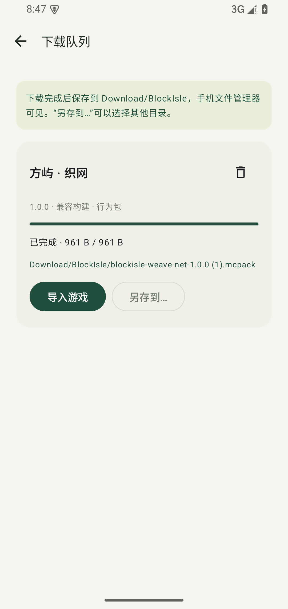
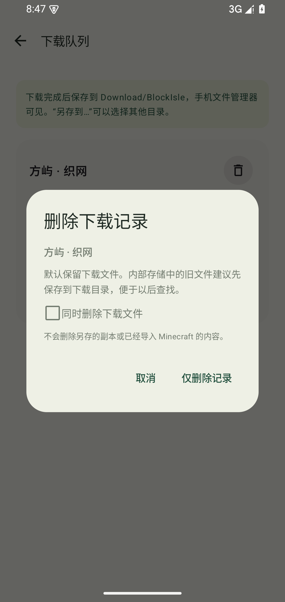

# 方屿 BlockIsle

Minecraft 基岩版国际版的 Android 个人资源中心。

[下载 v0.1.2 APK](https://github.com/junnhwan/blockisle/releases/download/v0.1.2/BlockIsle-0.1.2-android.apk) · [加速下载](https://gh-proxy.org/https://github.com/junnhwan/blockisle/releases/download/v0.1.2/BlockIsle-0.1.2-android.apk) · [发布说明](https://github.com/junnhwan/blockisle/releases/tag/v0.1.2) · [自制资源目录](https://github.com/junnhwan/blockisle-content)

## 当前功能

- 资源、自制、游戏、我的四个入口；默认跨类型发现与搜索附加包、材质、光影、皮肤和地图。
- MCPEDL.com、MCPEDL.org、苦力怕论坛原生列表、搜索、分页、详情与公开下载入口。各源类型覆盖与获取方式分别展示。
- 资源按来源和作者标注的游戏大/小版本筛选；包自身版本与适用游戏范围分别显示，支持 Action & Stuff 常见搜索写法。
- 游戏页有正式/测试版、大版本/分支、20条分页、跳页、排序和完整目录缓存；APK主渠道 MCPEDL.org，MCAPKS网盘备用。
- 下载成品保存到公共 `Download/BlockIsle`，手机文件管理器可见；旧内部文件可迁移。下载记录可删除，默认保留成品，也可选择同时删除对应文件。
- 原生下载队列、速度、暂停/继续/取消、可用摘要校验、另存和Minecraft导入入口；文件旁可直接选择浏览器下载。
- GitHub自制目录、固定版本构建、本地标准包导入、作品信息编辑、收藏和皮肤旋转预览。
- 浅色/深色外观、手动检查更新。

## 截图

下载管理截图来自0.1.2正式APK的Android15专用模拟器；资源/游戏截图为0.1.1。

| 跨来源搜索 | 来源与版本筛选 |
| --- | --- |
|  |  |

| 游戏分页 | 小版本分支 |
| --- | --- |
|  |  |

| 下载位置 | 删除记录与文件 |
| --- | --- |
|  |  |

## 安装与验证

Android8及以上。沿用原签名，从0.1.1覆盖升级，示例收藏1→1保留；旧961字节下载迁移到公共目录后摘要一致。公开官方和gh-proxy.org完整APK已下载核对。

0.1.2的39项单元测试、6项下载管理/真实下载检查通过，Lint 0 errors。旧版文件迁移、只删记录保留文件、勾选删除、活动任务停止清理、成品正确后缀和公共URI导入均已验证。0.1.1记录的第三方源网络波动与真机/游戏内效果边界保持，未在本轮全部重新验收。

版本匹配依据作者/来源标注，未标注内容明确显示；论坛等来源筛选当前已加载条目，仍可继续加载更多。网页、网盘、公开文件与需要登录/回复的来源分别处理。

## 文件校验

BlockIsle-0.1.2-android.apk：13,034,421字节。

SHA-256：`e280c458e16ca952cdc389721865d946d281506b32d02a968a68e11e97d487c4`

源码由独立私有仓库维护。本仓库仅分发APK、版本资料与截图。
