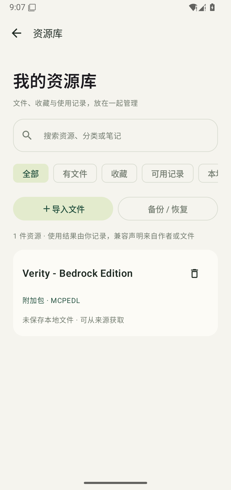
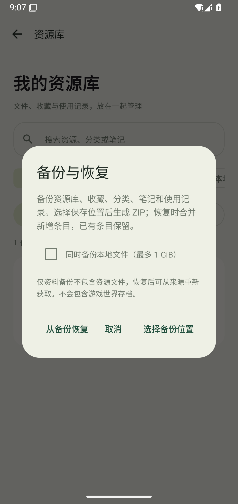
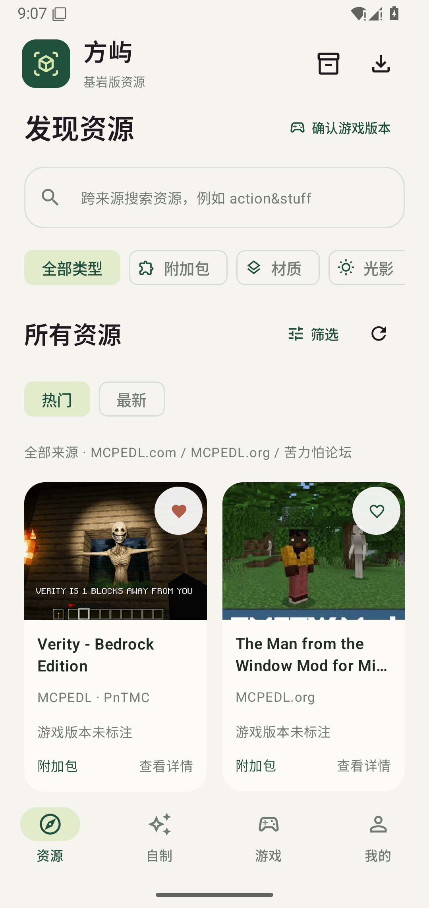
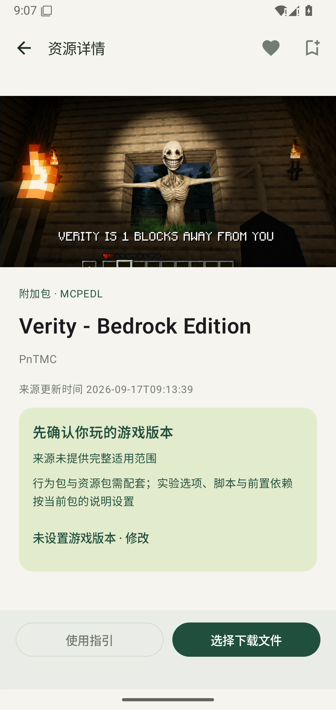

# 方屿 BlockIsle

Minecraft 基岩版国际版的 Android 个人资源中心。

[下载 v0.2.0 APK](https://github.com/junnhwan/blockisle/releases/download/v0.2.0/BlockIsle-0.2.0-android.apk) · [加速下载](https://gh-proxy.org/https://github.com/junnhwan/blockisle/releases/download/v0.2.0/BlockIsle-0.2.0-android.apk) · [发布说明](https://github.com/junnhwan/blockisle/releases/tag/v0.2.0) · [自制资源目录](https://github.com/junnhwan/blockisle-content)

## 当前功能

- 资源、自制、游戏、我的四个入口；MCPEDL.com、MCPEDL.org、苦力怕论坛的原生列表、跨类型搜索、分页、详情和公开文件入口。
- 按来源及游戏版本查找，支持中文组合词、常见英文别名与最近搜索；来源失效分别提示并保留缓存。
- 统一资源库：下载文件、本地导入与收藏，支持分类、笔记和个人使用结果记录；ZIP 备份可选包含本地文件，恢复时保留已有资料。
- 资源详情提供兼容条件、包声明与依赖、资源发布版本选择、明确配套文件下载、分类使用/排错指引与截图大图。
- 原生下载队列、状态筛选、暂停/继续/取消、来源重新解析、文件长度和可用摘要校验；成品保存公共 `Download/BlockIsle`，另存与记录/文件分别删除。
- 游戏目录正式/测试版、大版本/分支、20条分页和离线缓存；主渠道 MCPEDL.org，MCAPKS 网盘备用；安装前核对所选版本/ABI与已有签名。
- GitHub 自制目录、本地标准包导入、经典/纤细及衣帽外层皮肤预览、浅色/深色外观和手动检查更新。

## 0.2.0 实际界面

以下为正式 APK 在 Android15 专用模拟器中的实际界面，使用来源资源及示例收藏。

| 资源库 | 备份与恢复 |
| --- | --- |
|  |  |

| 发现资源 | 兼容条件与使用入口 |
| --- | --- |
|  |  |

## 安装与验证

Android8及以上，沿用原签名覆盖升级；本轮0.1.2→0.2.0升级示例收藏1→1保留。52项单元测试与10项Android15离线数据/存储/交互检查通过，Lint 0 errors。按用户要求，本次未重新下载第三方资源或公开APK做传输复验，由用户检查更新及实际网络体验。

作者/来源版本范围、静态包声明、目录实测和用户个人使用记录分别展示，不能互相替代。真机网络、Minecraft内导入/启用/玩法、光影设备效果及Android8/9权限分支仍需按实际设备确认。备份不包含Minecraft世界存档。

## 文件校验

BlockIsle-0.2.0-android.apk：13,149,109字节。

SHA-256：`b47e9e124d60e0fb042237e78e1c2d6efa0e9e7d6ef5cdf00c85d92906a6fe0b`

源码由独立私有仓库维护。本仓库只分发APK、版本资料与截图。
