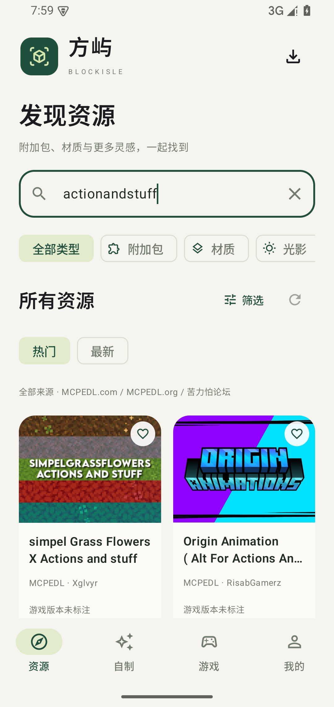
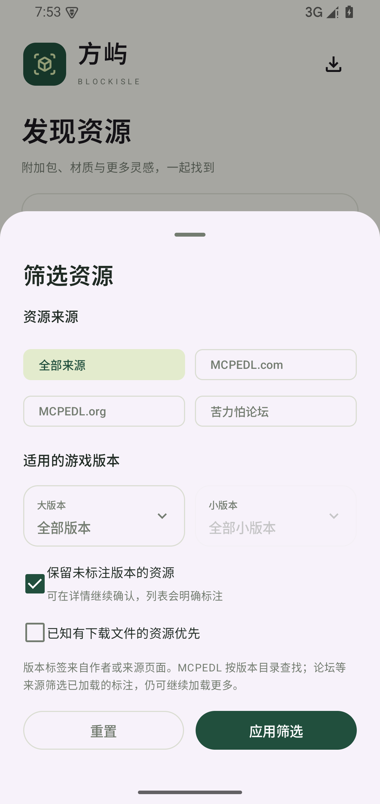
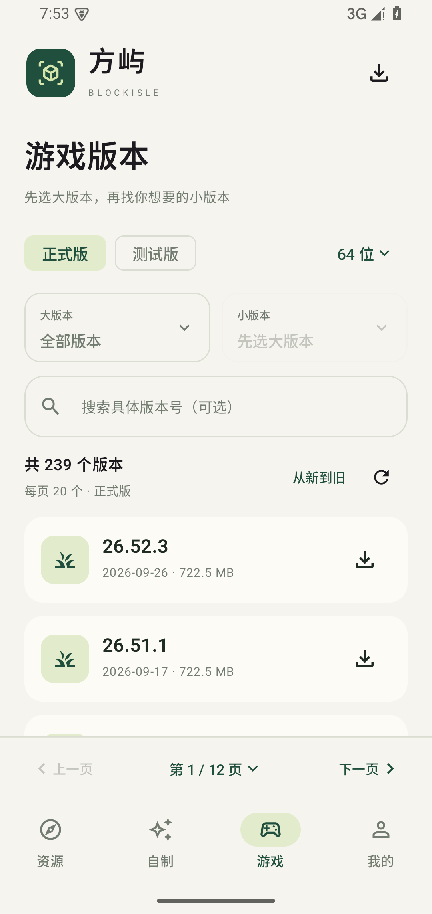
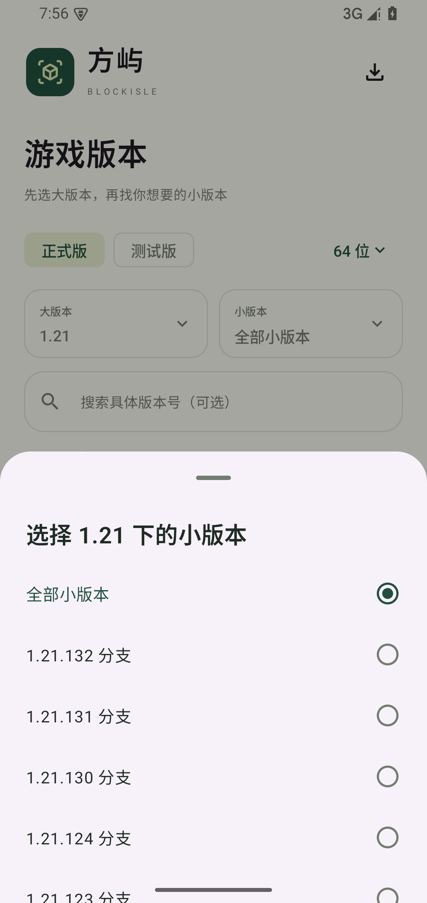

# 方屿 BlockIsle

Minecraft 基岩版国际版的 Android 个人资源中心。

[下载 v0.1.1 APK](https://github.com/junnhwan/blockisle/releases/download/v0.1.1/BlockIsle-0.1.1-android.apk) · [加速下载](https://gh-proxy.org/https://github.com/junnhwan/blockisle/releases/download/v0.1.1/BlockIsle-0.1.1-android.apk) · [发布说明](https://github.com/junnhwan/blockisle/releases/tag/v0.1.1) · [自制资源目录](https://github.com/junnhwan/blockisle-content)

## 当前功能

- 资源、自制、游戏、我的四个入口；默认跨类型发现与搜索附加包、材质、光影、皮肤和地图。
- MCPEDL.com、MCPEDL.org、苦力怕论坛原生列表、搜索、分页、详情与公开下载入口。各源类型覆盖与获取方式分别展示。
- 资源按来源和作者标注的游戏大/小版本筛选；包自身版本与适用游戏范围分别显示，支持 Action & Stuff 常见搜索写法。
- 游戏页有正式/测试版、大版本/分支、20条分页、跳页、排序和完整目录缓存；APK主渠道 MCPEDL.org，MCAPKS网盘备用。
- 原生下载队列、速度、暂停/继续/取消、可用摘要校验、导出和Minecraft导入入口；文件旁可直接选择浏览器下载。
- GitHub自制目录、固定版本构建、本地标准包导入、作品信息编辑、收藏和皮肤旋转预览。
- 浅色/深色外观、手动检查更新。

## 截图

以下为0.1.1正式APK在Android15专用模拟器中的实际界面。

| 跨来源搜索 | 来源与版本筛选 |
| --- | --- |
|  |  |

| 游戏分页 | 小版本分支 |
| --- | --- |
|  |  |

## 安装与验证

Android8及以上。沿用0.1.0签名覆盖升级，示例收藏1→1保留。公开官方和gh-proxy.org完整APK已下载核对。

34项单元测试通过；最新完整联网/交互批次9/10通过，大文件下载仍在模拟器中出现间歇超时；Action & Stuff曾在独立测试中整包下载和检查通过，保留并列浏览器直下入口。论坛公开小附件原生完整下载及摘要核对通过。真机网络、Minecraft内玩法和光影效果另行实测。

版本匹配依据作者/来源标注，未标注内容明确显示；论坛等来源筛选当前已加载条目，仍可继续加载更多。网页、网盘、公开文件与需要登录/回复的来源分别处理。

## 文件校验

BlockIsle-0.1.1-android.apk：13,001,533字节。

SHA-256：`1ecd944da919154115ec373b97081f5562e58c4b14e90b00af56d61bf8c2232a`

源码由独立私有仓库维护。本仓库仅分发APK、版本资料与截图。
