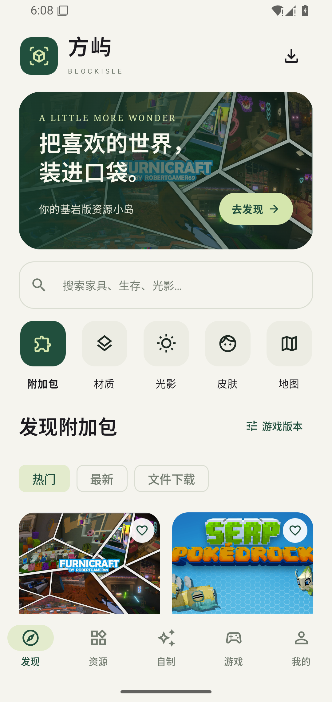
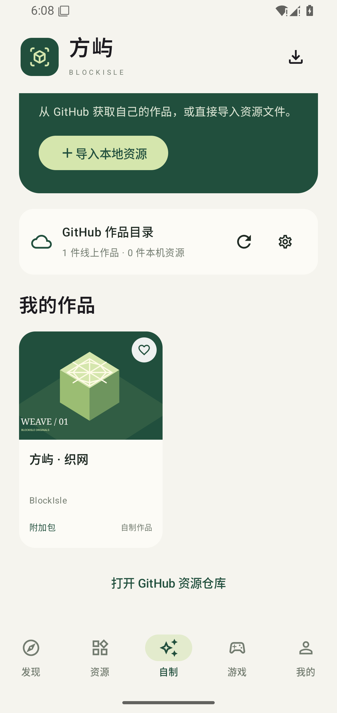

# 方屿 BlockIsle

把喜欢的方块世界，装进口袋。Minecraft 基岩版国际版的 Android 个人资源中心。

[下载 APK](https://github.com/junnhwan/blockisle/releases/latest) · [自制资源目录](https://github.com/junnhwan/blockisle-content)

## 首版功能

- 发现附加包、材质、光影、单张皮肤和地图；搜索、分页、来源详情、版本标签与收藏。
- 原生下载进度/速度、暂停/继续/取消、文件校验、导出和 Minecraft 导入入口。
- GitHub 自制作品目录、兼容构建下载、本地标准包导入与作品信息编辑。
- 单张皮肤 PNG 与经典/纤细模型旋转预览。
- 游戏 APK 以 MCPEDL.org 为主渠道，MCAPKS 提供版本目录和网盘备用。
- 浅色/深色外观、手动检查更新。

## 截图

以下是 Android 15 模拟器中的真实界面。

| 发现资源 | 自制作品 |
| --- | --- |
|  |  |

## 安装与更新

下载 Release 的 BlockIsle APK，允许系统安装后打开。Android 8.0 及以上；本次在 Android 11/15 模拟器完成相应验证。后续沿用相同签名覆盖更新，应用内提供手动检查更新和 GitHub 官方入口。

资源的来源声明、文件检查与游戏内实测分别记录。App 下载验证不等于模组玩法或光影效果已经在你的手机验收；请按作者条件导入并在游戏中启用。

源码由独立私有仓库维护。本仓库仅分发 APK、版本资料与截图。
